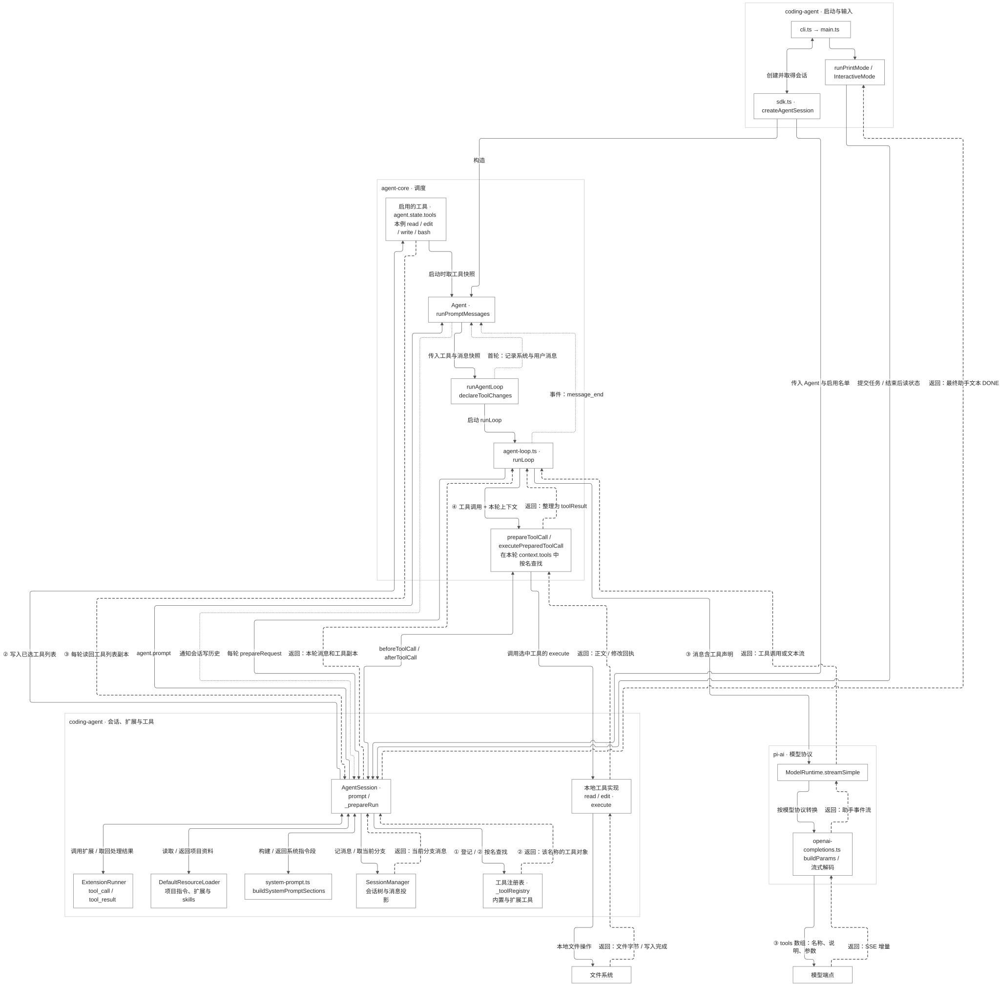
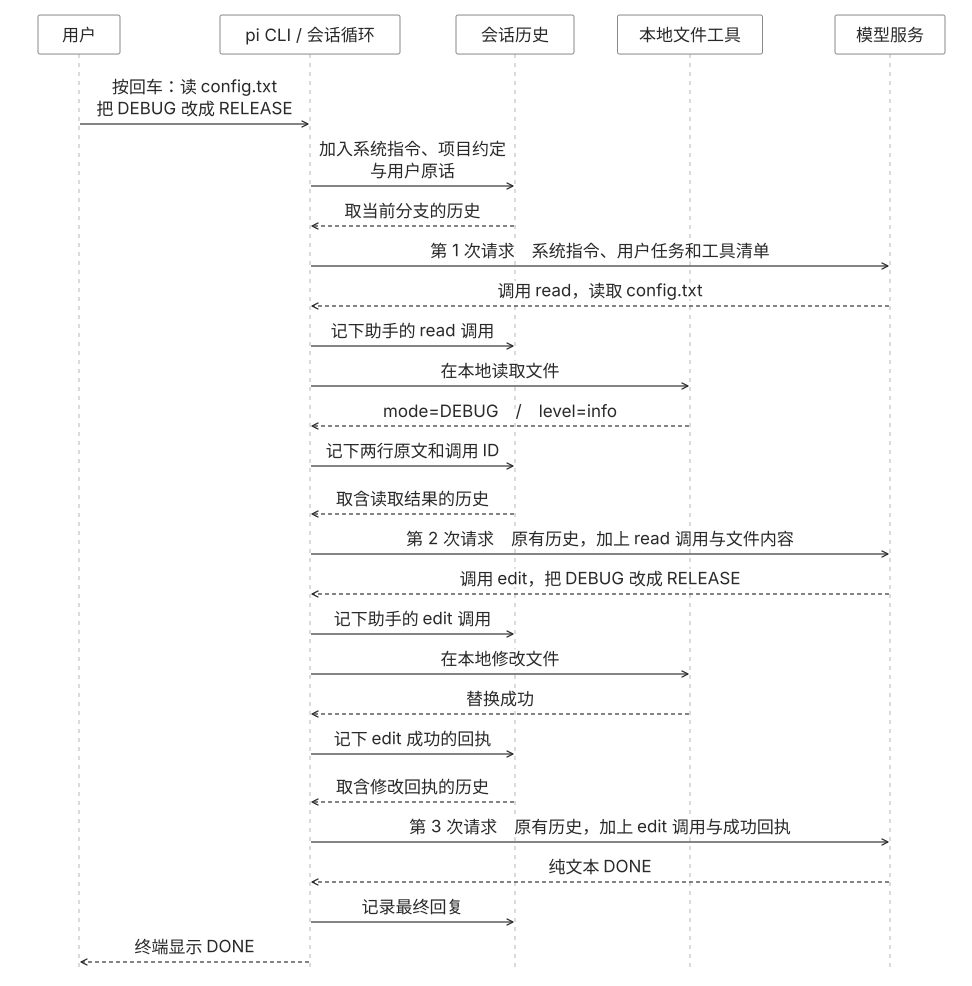
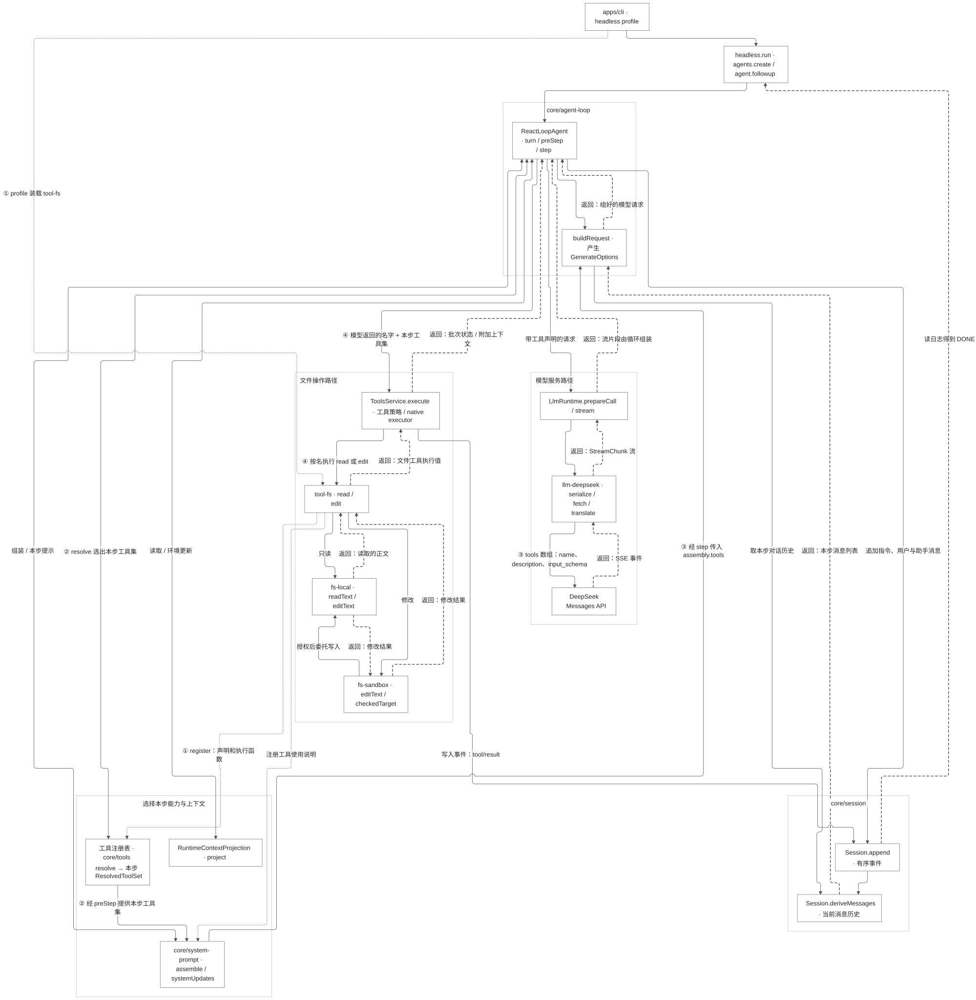
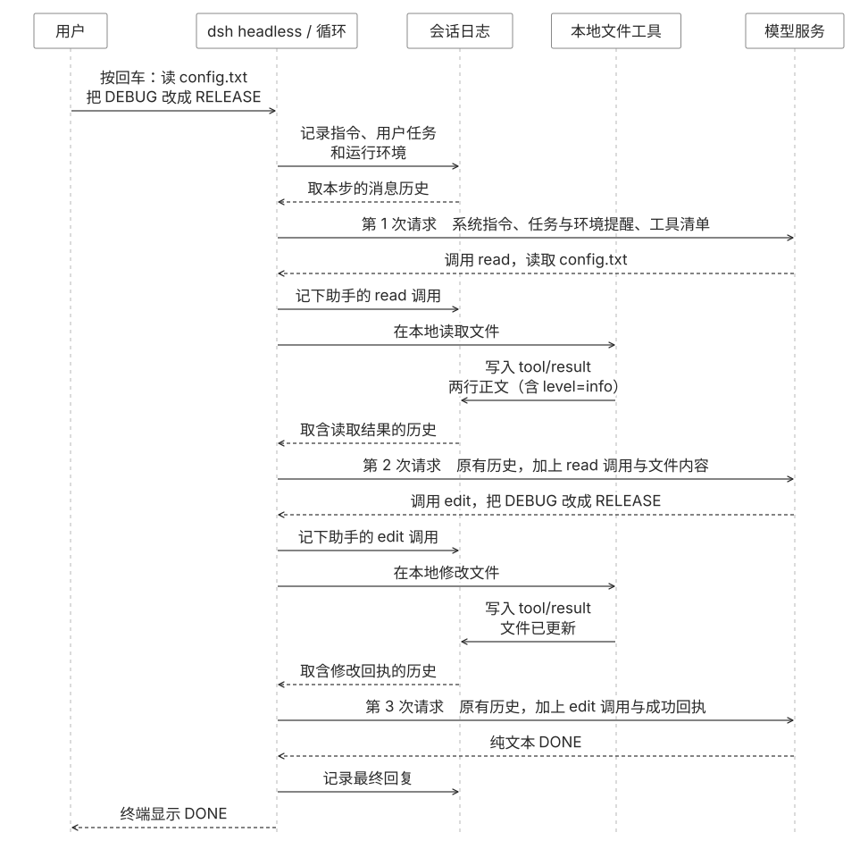

# 从一个 agent 循环讲到 pi 和 dsh

**40 分钟 · AI 工程师部门分享**

| 时间 | 要解决的问题 |
|---|---|
| 00:00–06:00 | 同一句 CI 诊断，为什么有时得去读日志，有时可以直接结束？现场跑 ReAct 的两个分支。 |
| 06:00–20:00 | 先认 pi 的源码结构，连看三份 JSON，再沿时序图回看。最后试一次：模型读完以后，磁盘上的文件被人改了。 |
| 20:00–34:30 | 换到 dsh，看组件怎么装、历史怎么记。三份 JSON 看全，再动手换工具执行器，看两次有依赖的读取中间是否还要再问模型。 |
| 34:30–37:00 | 在工具清单、执行检查和文件服务这几个位置接插件，各能改变什么？ |
| 37:00–38:00 | 三种记忆插件把同一句约定写在哪里，新会话怎样取回来？ |
| 38:00–40:00 | 拿团队要干的活、准备接的模型和同模型评测，一起比较两套 harness。 |

现场代码在第 2、3、10、19 页。第 6–8 页和第 14–16 页分别保留 pi、dsh 正常读改任务的三份请求，可以快速翻看，也可以随时切换「本地组装」「发给模型」「模型回复」。长 JSON 和源码入口留在文中供细看。观众提问另算。 [完整请求和本地会话记录](./harness-requests.json)

## 00:00–06:00　从一次 CI 失败看 ReAct

### 00:00　第 1 页　工具调用中间，harness 干了什么？

平时我让助手查个问题，过一会儿它就回我一句“查到了”。中间到底是谁去拿的数据？它怎么知道还该不该再调用一次工具？

我之前写过一个分析 GitHub 仓库的 Notebook。模型先看到有哪些工具，给出工具名和参数，Python 在本机把这个名字对应到函数，再把结果交回去。翻那个 Notebook，我最想保留的是逐轮输出，能看到它刚拿到了什么、凭什么挑下一个动作。今天先拿一个能现场改结果的小例子跑起来，再去 pi 和 dsh 源码里找同样的一趟。 [GitHub 仓库分析 Notebook](https://github.com/TallMessiWu/react-agent/blob/main/agent.ipynb)

### 00:40　第 2 页　第 128 次 CI 为什么挂了？

我只说了“帮我看看，第 128 次 CI 为什么挂了”。没说哪个任务失败，也没给日志。我给助手两个工具：`list_jobs` 查一次构建有哪些任务，`read_log` 拿一个任务编号去查日志。先只跑上面这一格。

```python
from presentation_labs import react_ci as ci
messages = [{"role": "user", "content": ci.TASK}]
call = ci.mock_llm(messages, ci.TOOLS)
print("工具声明", ci.signatures(ci.TOOLS))
print("模型回复", ci.describe(call))
```

屏幕上出现 `list_jobs(run_id=128)`。到这儿模型只提出要查，我还答不上是构建挂了还是单测挂了。接着运行下面这一格。

```python
with ci.local_tools(tests_pass=False) as executors:
    reader = executors[call["tool"]]
    jobs = reader(**call["args"])
    print("本地函数", reader.__qualname__)
    print("读取结果", ci.short(jobs))
```

现在 Python 根据工具名选中本机函数，查到两条记录。`build` 通过，编号 41；`unit-tests` 失败，编号 42。ReAct 里刚才点名调用的动作叫 action，拿回来的这组任务状态叫 observation。下一轮能填对 `read_log` 的编号，靠的就是这次返回。 [ReAct 作者的示例](https://react-lm.github.io/)

### 03:00　第 3 页　全绿时还会去读日志吗？

把刚才那两步放回循环。运行第 3 页，留意每轮打印的输入、模型回复和本地返回。这里的模拟模型只看刚收到的消息，按预写规则选动作。实际的工具函数去临时目录里读这次生成的任务和日志文件。

1. 默认 `tests_pass = False`，第一轮读到失败任务 #42。编号跟着 `messages.append(result)` 进入历史。
2. 第二轮，模型提出 `read_log(job_id=42)`，日志返回 `FAIL test_invoice_total: expected 100, got 90`。第三轮才把这个结果答给用户。
3. 现在把开关改成 `True`，问大家“这次会少哪一轮？”按 **Ctrl + Enter**。同样的用户任务，第一次工具返回却是全绿。第二轮直接给出结论，连 `read_log` 都没调用。

刚才我们能看见这两个分支，因为整个循环是自己写的。现在换成真正的 harness。我挑了 dsh 仓库的 `fs-edit` 测试：读 `config.txt`，把 `DEBUG` 换成 `RELEASE`，最后只答 `DONE`。用户原话、改前改后的文件和中间的工具回执都有记录，正好把同一道题交给 pi、dsh，再逐轮对照。 [测试文件和预期结果](https://github.com/deepseek-ai/deepseek-harness/tree/4b399c39a6d1479cd84ca591b4d7c88e24d38a96/snapshots/session/fs-edit) · [测试录制](https://github.com/deepseek-ai/deepseek-harness/blob/4b399c39a6d1479cd84ca591b4d7c88e24d38a96/snapshots/session/fs-edit/session.v4.jsonl#L10-L25)

## 06:00–20:00　在 pi 里追一次文件修改

### 06:00　第 4 页　先看 pi 的源码架构

刚才的 Python 有一张工具声明表，还有一份能执行的函数。换成 pi，这两样在哪里接起来？从“用户入口”进入，找到 `AgentSession`，再选“可用工具”，跟着一个 `read` 去注册表里走一个来回。

图 1　pi CLI 的源码架构



[单独打开放大架构图](./pi-architecture.svg)

这里先分清两个名字。`AgentSession` 是管这段会话的本地对象，`agent.state.tools` 是它所管理的 `Agent` 当前启用的工具列表。拿 `read` 跟两次回到会话的箭头：

1. **选工具时，注册表 → AgentSession。** 这次命令行把 `read,edit,write,bash` 这四个**名字**交给会话。注册表就在 `AgentSession` 自己里面：会话按名调用 `_toolRegistry.get("read")`，拿回带有 `execute` 的 `read` 对象。四个名字逐个取完，**会话把选好的对象组成列表，写进 `agent.state.tools`**。图上的“返回：该名称的工具对象”就是这一趟的回程。[CLI 启用名单](https://github.com/earendil-works/pi/blob/8209929fb553e7a8c91dc0894569f9ec43dd201f/packages/coding-agent/src/core/sdk.ts#L280-L294) · [按名取对象](https://github.com/earendil-works/pi/blob/8209929fb553e7a8c91dc0894569f9ec43dd201f/packages/coding-agent/src/core/agent-session.ts#L1671-L1677) · [写入工具列表](https://github.com/earendil-works/pi/blob/8209929fb553e7a8c91dc0894569f9ec43dd201f/packages/coding-agent/src/core/agent-session.ts#L1710-L1717)
2. **每轮发包前，agent.state.tools → AgentSession → runLoop。** 循环调用 `prepareRequest`，由会话从当前分支取历史，再用 `this.agent.state.tools.slice()` 取一份当前工具列表。它把两样东西一起装进本轮上下文，交回循环。因此图上有两根相接的长虚线：“每轮读回工具列表副本”指向会话，“本轮消息和工具副本”从会话指向循环。[会话准备并返回上下文](https://github.com/earendil-works/pi/blob/8209929fb553e7a8c91dc0894569f9ec43dd201f/packages/coding-agent/src/core/agent-session.ts#L852-L879) · [循环取回上下文](https://github.com/earendil-works/pi/blob/8209929fb553e7a8c91dc0894569f9ec43dd201f/packages/agent/src/agent-loop.ts#L228-L251)

图里还有一条从 `agent.state.tools` 通向循环的线。启动循环时，`Agent` 会先取一份包含工具的快照，循环用它记录工具声明；上面第 2 步的回流线，画的是每轮发送前会话再取当前工具列表。两处读取的是同一份 Agent 状态。[启动循环时取快照](https://github.com/earendil-works/pi/blob/8209929fb553e7a8c91dc0894569f9ec43dd201f/packages/agent/src/agent.ts#L441-L473)

到了模型那一侧，用第一份请求里的 `tools[0].function` 对照：名字是 `read`，带有用途说明和路径参数 `path`。`pi-ai` 把消息中记录的声明放进出站的 `tools`。模型回了 `read` 这个名字后，分派层再到本轮的工具集合里查找并执行。`execute` 一直留在本机。[声明如何记录](https://github.com/earendil-works/pi/blob/8209929fb553e7a8c91dc0894569f9ec43dd201f/packages/agent/src/agent-loop.ts#L333-L369) · [发送工具声明](https://github.com/earendil-works/pi/blob/8209929fb553e7a8c91dc0894569f9ec43dd201f/packages/ai/src/api/openai-completions.ts#L847-L849) · [模型点名后执行](https://github.com/earendil-works/pi/blob/8209929fb553e7a8c91dc0894569f9ec43dd201f/packages/agent/src/agent-loop.ts#L721-L738)

先找 `runLoop`。沿实线看谁调用谁，沿标有返回内容的长虚线逆向读。短点线 `message_end` 表示会话订阅的事件。Notebook 的「突出回流」会保留结果与记历史的路径，淡化普通调用。

- **模型回了什么？** 从模型端点往回走：SSE 增量进入 `pi-ai` 的适配器，转成助手消息事件流交给循环。循环收齐后，第一轮拿到 `read` 调用，最后一轮拿到文本 `DONE`。[适配器返回事件流](https://github.com/earendil-works/pi/blob/8209929fb553e7a8c91dc0894569f9ec43dd201f/packages/ai/src/models.ts#L958-L969) · [循环消费响应](https://github.com/earendil-works/pi/blob/8209929fb553e7a8c91dc0894569f9ec43dd201f/packages/agent/src/agent-loop.ts#L412-L465)
- **两行文件内容去了哪？** `read` 从文件系统读回内容，把正文交给工具分派。工具批次将结果整理成 `toolResult`；`message_end` 经 `Agent` 通知 `AgentSession` 追加到会话历史。下一轮再从 `SessionManager` 取出当前分支的消息，`level=info` 这才进入发给模型的输入。[工具返回和结果消息](https://github.com/earendil-works/pi/blob/8209929fb553e7a8c91dc0894569f9ec43dd201f/packages/agent/src/agent-loop.ts#L824-L853) · [会话接收消息](https://github.com/earendil-works/pi/blob/8209929fb553e7a8c91dc0894569f9ec43dd201f/packages/coding-agent/src/core/agent-session.ts#L1215-L1235)
- **终端怎么拿到 `DONE`？** `runPrintMode` 等待任务完成，再读取 `session.state.messages` 的最后一条助手文本，写到标准输出。[print 模式读取最终结果](https://github.com/earendil-works/pi/blob/8209929fb553e7a8c91dc0894569f9ec43dd201f/packages/coding-agent/src/modes/print-mode.ts#L137-L158)

```mermaid
---
config:
  theme: base
  themeVariables:
    background: "#ffffff"
    primaryColor: "#ffffff"
    primaryTextColor: "#303030"
    primaryBorderColor: "#757575"
    secondaryColor: "#ffffff"
    secondaryTextColor: "#303030"
    secondaryBorderColor: "#999999"
    tertiaryColor: "#ffffff"
    tertiaryTextColor: "#303030"
    tertiaryBorderColor: "#c4c4c4"
    mainBkg: "#ffffff"
    clusterBkg: "#ffffff"
    clusterBorder: "#c4c4c4"
    edgeLabelBackground: "#ffffff"
    nodeBorder: "#757575"
    lineColor: "#505050"
    textColor: "#303030"
    titleColor: "#303030"
  flowchart:
    nodeSpacing: 34
    rankSpacing: 32
    padding: 11
---
flowchart TB
  subgraph CLI["coding-agent · 启动与输入"]
    boot["cli.ts → main.ts"]
    sdk["sdk.ts · createAgentSession"]
    mode["runPrintMode / InteractiveMode"]
    boot <-->|创建并取得会话| sdk
    boot --> mode
  end
  subgraph Session["coding-agent · 会话、提示词与本地工具"]
    sess["AgentSession · prompt / _prepareRun"]
    load["DefaultResourceLoader<br/>项目指令、扩展与 skills"]
    prompt["system-prompt.ts<br/>buildSystemPromptSections"]
    hist["SessionManager<br/>会话树、消息与上下文投影"]
    defs["工具注册表 · _toolRegistry<br/>内置 read / edit / write 等 + 扩展工具"]
    load -->|提供 prompt 输入| sess
    sess <-->|构建 / 返回系统指令段| prompt
    sess -->|记消息 / 读取当前分支| hist
    sess -->|① 登记 / ② 按名查找| defs
  end
  subgraph Core["agent-core · 调度"]
    toolset["本轮可用工具 · agent.state.tools<br/>本例 read / edit / write / bash"]
    agent["Agent · runPromptMessages"]
    loopNode["agent-loop.ts · runLoop"]
    dispatch["prepareToolCall / executePreparedToolCall"]
    agent --> loopNode
    loopNode -->|模型点名 read + 参数| dispatch
  end
  subgraph Network["pi-ai · 模型协议"]
    route["ModelRuntime.streamSimple"]
    api["openai-completions.ts<br/>buildParams / 流式解码"]
    route -->|按模型协议转换| api
  end
  sdk -->|构造| agent
  sdk -->|传入 Agent 与启用名单| sess
  mode -->|提交任务 / 结束后读状态| sess
  sess -->|agent.prompt| agent
  loopNode -->|③ 消息带工具声明| route
  loopNode -.->|事件：message_end| agent
  agent -.->|事件：通知会话写历史| sess
  dispatch -->|④ 调用选中实现的 execute| defs
  defs -->|本地文件操作| fs["文件系统"]
  api -->|③ tools 数组：名称、说明、参数| model["模型端点"]
  model -.->|返回：SSE 增量| api
  api -.->|返回：助手事件流| route
  route -.->|返回：工具调用或文本流| loopNode
  fs -.->|返回：文件字节 / 写入完成| defs
  defs -.->|返回：正文 / 修改回执| dispatch
  dispatch -.->|回流：批次整理为 toolResult| loopNode
  hist -.->|返回：当前分支消息| sess
  loopNode -->|每轮 prepareRequest| sess
  sess -.->|返回：本轮消息和工具副本| loopNode
  sess -.->|读得最终助手文本 DONE| mode
  defs -.->|② 返回：该名称的工具对象| sess
  sess -->|② 写入已选工具列表| toolset
  toolset -.->|③ 每轮读回工具列表副本| sess
  toolset -->|③ 由循环提取声明| loopNode
  toolset -->|④ 供分派按名查找| dispatch
  click sdk href "https://github.com/earendil-works/pi/blob/8209929fb553e7a8c91dc0894569f9ec43dd201f/packages/coding-agent/src/core/sdk.ts#L403" "打开固定版本源码"
  click sess href "https://github.com/earendil-works/pi/blob/8209929fb553e7a8c91dc0894569f9ec43dd201f/packages/coding-agent/src/core/agent-session.ts#L2011" "打开固定版本源码"
  click loopNode href "https://github.com/earendil-works/pi/blob/8209929fb553e7a8c91dc0894569f9ec43dd201f/packages/agent/src/agent-loop.ts#L189" "打开固定版本源码"
  click dispatch href "https://github.com/earendil-works/pi/blob/8209929fb553e7a8c91dc0894569f9ec43dd201f/packages/agent/src/agent-loop.ts#L725" "打开固定版本源码"
  click api href "https://github.com/earendil-works/pi/blob/8209929fb553e7a8c91dc0894569f9ec43dd201f/packages/ai/src/api/openai-completions.ts#L787" "打开固定版本源码"
  click defs href "https://github.com/earendil-works/pi/blob/8209929fb553e7a8c91dc0894569f9ec43dd201f/packages/coding-agent/src/core/tools/edit.ts#L180" "打开固定版本源码"
  click toolset href "https://github.com/earendil-works/pi/blob/8209929fb553e7a8c91dc0894569f9ec43dd201f/packages/coding-agent/src/core/agent-session.ts#L1669" "启用本轮工具"
  linkStyle 19,20,21,22,23,24,25,27,28,29,31 stroke:#444444,stroke-width:1.65px,stroke-dasharray:7 4;
```

<details>
<summary>展开原版 Mermaid 架构图及源码入口</summary>



</details>

### 08:00　第 5 页　第一轮发出之前，pi 已经拿到了什么？

图上的入口现在有了名字。先看投影左边，这才是用户在终端里输入的全部。

> First use the read tool to read config.txt in the current directory. Then use the edit tool (NOT bash) to replace the literal text DEBUG with RELEASE in that file. Then reply with exactly the single word DONE.

我敲到这里就按回车了。后面大家会在请求里看到很多别的英文，先记住哪一句是我写的。pi 给这段输入标上来源：`role` 表示是谁说的，用户自己输入的就叫 `user`；`content` 装正文。这次正文只有一个文本块。这是从本地会话里**单独抽出的用户这一项**，保留开头一句供大家认出来：

```json
{
  "role": "user",
  "content": [{"type": "text", "text": "First use the read tool to read config.txt in the current directory. …"}]
}
```

为了能逐项对照，我在本机跑这版 pi，保存它在发送前准备的会话消息和交给网络层的 JSON。模型的回答用预先准备的内容回放，读写文件由 pi 真正执行。

再看右边那句英文，是我放进临时项目 `AGENTS.md` 的。里面只有一行，`Keep unrelated configuration values unchanged.`，意思是“只改这次要求改的配置项，其他项保持原样”。落到我们的文件，就是改 `mode`，保留 `level=info`。pi 准备首包时把这句约定和它自带的工作说明一起放进 `system`，用户在终端打的任务仍放在 `user`。这时模型已经知道要保留其他配置；具体还有哪几行，得等 `read` 把文件正文带回来。

工具清单也有了。之前录正常请求时给 pi 启用了 `read`、`edit`、`write` 和 `bash`。本地注册的工具各有名字、用法和执行函数。pi 需要把可调用的名字和用法告诉模型，真正打开文件的函数留在本机。

### 09:30　第 6 页　第一份请求里有没有文件内容？

先停在**本地会话刚准备好、还没交给模型适配器**的地方。下面是从同一次回放取出的两条内部消息。第一条把工作说明按段保存：`preamble` 是开场指令，`project_context` 里包含项目约定。`toolsAdded` 记录首次声明的工具，例子里每项只展开名字。第二条还是刚才的用户输入。长字符串中的 `…` 表示投影时折叠的原文，完整数据在附件的 `pi.local_before_send[0]`。[pi 组装系统提示的源码](https://github.com/earendil-works/pi/blob/8209929fb553e7a8c91dc0894569f9ec43dd201f/packages/coding-agent/src/core/system-prompt.ts#L128-L189)

```json
[
  {
    "role": "system",
    "sections": {
      "preamble": "You are a coding assistant running inside pi, a coding agent harness. Help users inspect files, run commands, and modify code.",
      "project_context": "…\nKeep unrelated configuration values unchanged.\n…"
    },
    "toolsAdded": [{"name": "read"}, {"name": "edit"}, {"name": "write"}, {"name": "bash"}]
  },
  {
    "role": "user",
    "content": [{"type": "text", "text": "First use the read tool to read config.txt in the current directory. …"}]
  }
]
```

现在才走到**发给 DeepSeek 的请求体**。适配器把工作说明的各段连成一段文字，放进 `messages` 里的第一条；用户任务是第二条。可调用的工具另列在外层 `tools`；`model` 指定这次用哪个模型。看下面就能对上：左边如果停在刚才的本地列表，右边的 `system` 和 `user` 都找得到来源。示例保留实际字段名、外层形状和消息顺序，只摘长文本与工具名字；每轮未经节选的 JSON 都在[请求附件](./harness-requests.json)。[本轮会话怎样交给适配器](https://github.com/earendil-works/pi/blob/8209929fb553e7a8c91dc0894569f9ec43dd201f/packages/coding-agent/src/core/agent-session.ts#L852-L879)

**发出 ① · pi 请求体节选。** `messages` 的两项都在，四个工具各保留名称，长文本以 `…` 折叠。

```json
{
  "model": "deepseek-flash",
  "messages": [
    {
      "role": "system",
      "content": "You are a coding assistant running inside pi, a coding agent harness. Help users inspect files, run commands, and modify code.\n…\nKeep unrelated configuration values unchanged.\n…"
    },
    {
      "role": "user",
      "content": [
        {
          "type": "text",
          "text": "First use the read tool to read config.txt in the current directory. …"
        }
      ]
    }
  ],
  "tools": [
    {"type": "function", "function": {"name": "read"}},
    {"type": "function", "function": {"name": "edit"}},
    {"type": "function", "function": {"name": "write"}},
    {"type": "function", "function": {"name": "bash"}}
  ]
}
```

> **台上操作**　在同一份请求里找两处文字。`Keep unrelated` 能找到，因为项目约定已经被 pi 读入；`level=info` 找不到，因为要求操作的 `config.txt` 还没人读过。工具出现在清单里，只能说明它可用。

### 11:30　第 7 页　第二份请求里多出了谁说的两句话？

模型回的是一个动作：“请用 `read` 读取 `config.txt`。”这种回复在会话里的作者叫 `assistant`。它带一个调用编号 `fs-edit-read`，相当于给这次读取贴了一张回执号。等本地工具读完文件，pi 拿着同一个号，把两行正文记为工具结果。本地会话把这种结果叫 `toolResult`。先看新增的这两项，文件内容出现在哪一项？

```json
[
  {
    "role": "assistant",
    "content": [
      {
        "type": "toolCall",
        "name": "read",
        "id": "fs-edit-read",
        "arguments": {"path": "config.txt", "offset": null, "limit": null}
      }
    ]
  },
  {
    "role": "toolResult",
    "toolCallId": "fs-edit-read",
    "content": [{"type": "text", "text": "mode=DEBUG\nlevel=info\n"}]
  }
]
```

这两项下一轮都要带回去。下面直接看**第二次请求的 `messages`**：前两条还是第一轮那份工作说明和用户任务；新增的一对里，`tool_calls` 表示模型上轮具体选中的动作，`role: "tool"` 表示这次调用的返回。调用号把它们配成一对。注意第一包的 `tools` 是四种可选工具，这儿的 `tool_calls` 只有已经选中的 `read`。[工具结果写进请求的位置](https://github.com/earendil-works/pi/blob/8209929fb553e7a8c91dc0894569f9ec43dd201f/packages/ai/src/api/openai-completions.ts#L1401-L1427)

**发出 ② · 完整消息顺序，共 4 项。** 前 2 项与上一轮相同，末尾两项是本轮新增。下面按原顺序显示每一项，长指令和部分字段折叠；`…` 由讲稿添加。本轮模型和工具清单沿用第一份。

```json
[
  {
    "role": "system",
    "content": "You are a coding assistant running inside pi, a coding agent harness. Help users inspect files, run commands, and modify code.\n…\nKeep unrelated configuration values unchanged.\n…"
  },
  {
    "role": "user",
    "content": [{"type": "text", "text": "First use the read tool to read config.txt in the current directory. …"}]
  },
  {
    "role": "assistant",
    "tool_calls": [
      {
        "id": "fs-edit-read",
        "type": "function",
        "function": {"name": "read", "arguments": "{\"path\":\"config.txt\",\"offset\":null,\"limit\":null}"}
      }
    ]
  },
  {"role": "tool", "tool_call_id": "fs-edit-read", "content": "mode=DEBUG\nlevel=info\n"}
]
```

这次 `level=info` 出现了。用户没有再打字，消息数却由 2 变成 4，因为中间有一项来自模型，一项来自工具。pi 每次发包会取当前会话分支走到这里的历史。同一分支的这个短任务里，我们实际看到第一轮的两条消息在第二轮原样保留。

台上可以直接切「连同前文」。这四项里，只有其中那条 user 是我敲的。现在模型既知道我要改什么，也知道文件当前是什么样子，下一步它选了 edit。

### 12:45　第 8 页　第三份请求带回来的是写入回执

模型看过原文，第二次回复选了 `edit`。它给了文件名、旧文本 `DEBUG` 和新文本 `RELEASE`。本地工具照这次调用去改文件，在会话里又添了一对：助手提出的 `edit`，以及写入成功的结果。这次的编号是 `fs-edit-replace`。如果用 `write`，模型就得给出整份要写入的内容；这里实际选的是 `edit`，只给一处替换。[本地 edit 及其返回值](https://github.com/earendil-works/pi/blob/8209929fb553e7a8c91dc0894569f9ec43dd201f/packages/coding-agent/src/core/tools/edit.ts#L181-L213)

**第三次请求的 `messages` 有六条。** 前四条沿用，最后两条刚加入。这次专门看最后一条的正文：

**发出 ③ · 完整消息顺序，共 6 项。** 前 4 项与上一轮相同，末尾两项是本轮新增。下面按原顺序显示每一项，长指令和部分字段折叠；`…` 由讲稿添加。本轮模型和工具清单沿用第一份。

```json
[
  {
    "role": "system",
    "content": "You are a coding assistant running inside pi, a coding agent harness. Help users inspect files, run commands, and modify code.\n…\nKeep unrelated configuration values unchanged.\n…"
  },
  {
    "role": "user",
    "content": [{"type": "text", "text": "First use the read tool to read config.txt in the current directory. …"}]
  },
  {
    "role": "assistant",
    "tool_calls": [
      {
        "id": "fs-edit-read",
        "type": "function",
        "function": {"name": "read", "arguments": "{\"path\":\"config.txt\",\"offset\":null,\"limit\":null}"}
      }
    ]
  },
  {"role": "tool", "tool_call_id": "fs-edit-read", "content": "mode=DEBUG\nlevel=info\n"},
  {
    "role": "assistant",
    "tool_calls": [
      {
        "id": "fs-edit-replace",
        "type": "function",
        "function": {
          "name": "edit",
          "arguments": "{\"path\":\"config.txt\",\"edits\":[{\"oldText\":\"DEBUG\",\"newText\":\"RELEASE\"}]}"
        }
      }
    ]
  },
  {
    "role": "tool",
    "tool_call_id": "fs-edit-replace",
    "content": "Successfully replaced 1 block(s) in config.txt."
  }
]
```

它说“成功替换了一个文本块”。如果这时把鼠标往上移，前一轮 `read` 的结果居然还写着 `mode=DEBUG`。这两条可以同时成立：一条是更改前读到的旧内容，一条是之后写入的回执。如果用户还想看改完的完整文件，得再读一次；这条任务只要求改完回 `DONE`。

切到「模型回复」，这才是最终回答。三份 JSON 都走过了，把它们放回一条时间线。

### 14:00　第 9 页　沿时序图回看刚才的三轮

从终端上的 DONE 反着找一遍。它来自第三轮的模型回复；模型说任务完成，依据是末尾的 edit 成功回执；这次 edit 选中的旧片段，又是第一回 read 读出来的。图上可以点「读取文件」和「修改文件」，分别看程序调用和工具返回走哪条线。

从第一条箭头往下读：用户按回车后，pi 准备请求。模型先要求 `read`，再要求 `edit`，最后一条 `DONE` 回到终端。



[单独打开放大这张时序图](./pi-request-sequence.svg)

> **台上操作**　看附件里三份 `pi.requests` 的最后一条消息：第一次是用户任务，第二次是读到的文件，第三次是写入成功的回执。再问：“哪一份里有助手已经回答的 `DONE`？”用户任务里一开始就有这个词，可真正的答案属于第三次**响应**。它在最后一份请求发出时还没发生。

展开「三轮消息数与最后一条消息」就能看到 2、4、6。每执行一次工具，历史多出一对消息。这里刚好有个前提：第一次读到的旧片段，第二次真正去改时还在。要是我趁中间把它改了，pi 究竟会覆盖，还是会发现？

### 16:00　第 10 页　在 read 和 edit 之间，换掉磁盘上的旧值

第 10 页现场启动新的 pi CLI。让它读临时文件，等第二份模型请求已经带上 read 的回执时，给 pi 的模拟响应先停一下。这个停点很重要：历史里的旧版本已经写定，而本地 edit 还没有收到执行指令。我们用代码格里的 Python 回调改磁盘，再让它继续。

```python
from presentation_labs.pi_lab import run_pi_edit
from presentation_labs.view_results import show_pi

interfere = True
def change_file(path):
    path.write_text("mode=STAGING\nlevel=info\n", encoding="utf-8")

pi_trial = run_pi_edit(after_read=change_file if interfere else None)
show_pi(pi_trial)
```

先让大家猜最终会留下哪个值，再运行。上次 read 的回执写着 DEBUG，此刻磁盘上已经是 STAGING。模拟模型仍按原提议调用 edit。pi 自己的文件工具重新读盘，找不到原片段，回了 `Could not find the exact text in config.txt.`。把这条错误塞进第三份请求时，模型还不晓得新值到底是什么。我们的模拟模型见到匹配失败才要求再读一遍，直到第四份请求才第一次看见 STAGING。现场表里的失败提示和两次读出的正文，都来自真正的文件工具。 [pi 读取文件并应用修改](https://github.com/earendil-works/pi/blob/8209929fb553e7a8c91dc0894569f9ec43dd201f/packages/coding-agent/src/core/tools/edit.ts#L178-L209) · [旧片段未找到时的回执](https://github.com/earendil-works/pi/blob/8209929fb553e7a8c91dc0894569f9ec43dd201f/packages/coding-agent/src/core/tools/edit-diff.ts#L295-L304)

把 `interfere` 改回 `False` 再跑，临时文件会重新从 DEBUG 开始。这次匹配成功，文件落到 RELEASE，模拟模型收到成功回执就答 DONE。之前内嵌的三份 JSON 保留的是正常录制；台上启动的这两次有自己的任务、调用编号和历史，可以展开 `pi_trial["rounds"]` 看。既然不同回执会让同一个任务多跑一轮，那到了 dsh，负责跑这几轮的代码是谁提供的？

## 20:00–34:30　在 dsh 里追同一个任务，再现场更换执行器

### 20:00　第 11 页　同一个任务交给 dsh，谁来跑这个循环？

在 pi 里，我们刚跟过这条调用链。模型选了 edit，pi 调本地工具，把成功回执接到历史里，再问一次模型。等这次模型答了 DONE，这个任务才结束。在 pi 的源码里，Agent 直接调用内置的 runAgentLoop。假如团队想在改 config.txt 前多检查一下路径，就在工具执行前接一个扩展。连 edit 的实现也可以换；要自己决定整个循环怎么跑，就得另外搭主程序，或者改核心代码。[Agent 怎样进入 runAgentLoop](https://github.com/earendil-works/pi/blob/8209929fb553e7a8c91dc0894569f9ec43dd201f/packages/agent/src/agent.ts#L441-L453) · [同名工具覆盖内置实现](https://github.com/earendil-works/pi/blob/8209929fb553e7a8c91dc0894569f9ec43dd201f/packages/coding-agent/docs/extensions.md#L2358-L2364)

现在把之前正常读、改、答的 fs-edit 任务交给 dsh。用户还是要它先读、再改、最后回 DONE，所以还是得有一段程序负责这几轮。换个问题：dsh 启动时，怎么知道该用谁来跑？打开配置，能找到 dsh-agent-loop。它是默认的循环插件。我们也可以按 AgentFactory 接口写自己的插件，再让配置选用它。接下来看架构图，先找命令行入口把这句任务交给了谁。[默认配置列出工具、循环和文件服务](https://github.com/deepseek-ai/deepseek-harness/blob/4b399c39a6d1479cd84ca591b4d7c88e24d38a96/packages/bundle/base/cordis.patch.yml#L524-L561) · [循环插件登记 Agent 工厂](https://github.com/deepseek-ai/deepseek-harness/blob/4b399c39a6d1479cd84ca591b4d7c88e24d38a96/packages/core/agent-loop/src/index.ts#L328-L338) · [AgentFactory 的创建与恢复约定](https://github.com/deepseek-ai/deepseek-harness/blob/4b399c39a6d1479cd84ca591b4d7c88e24d38a96/packages/core/agent/src/index.ts#L176-L220)

### 21:00　第 12 页　dsh 的源码架构

图 2　dsh headless 的源码架构



[并排看 pi 的架构图](./pi-architecture.svg) · [放大 dsh 的架构图](./dsh-architecture.svg)

> **台上操作**　选「循环由谁提供」，从 headless 的 `agents.create` 沿线找到默认的 `ReactLoopAgent`。现在回到任务开头：用户让它先读 config.txt，模型第一轮怎么知道有 `read` 可选？切到「可用工具」。

跟 pi 一样，模型在本次请求的 `tools` 中看见工具；dsh 的区别在于，**每一步从当前配置装载的插件中确定可用工具集**。

1. **登记、选用。** 这个 headless profile 装入了文件工具插件。插件启用 `read` 时向工具服务登记名字、说明、参数和执行函数；进入一个模型步骤时，循环调用 `tools.resolve`，得到这一步的 `toolSet`。[文件插件注册 read](https://github.com/deepseek-ai/deepseek-harness/blob/4b399c39a6d1479cd84ca591b4d7c88e24d38a96/packages/fs/tool-fs/src/read.ts#L67-L84) · [本步选择工具集](https://github.com/deepseek-ai/deepseek-harness/blob/4b399c39a6d1479cd84ca591b4d7c88e24d38a96/packages/core/agent-loop/src/agent.ts#L286-L303)
2. **发给模型。** 请求组装沿用这份集合，把工具声明交给 `buildRequest`。归档的这次任务有 **24 项工具声明**；在 DeepSeek Messages 请求的顶层 `tools` 找 `name: "read"`，旁边就是 `description` 和 `input_schema`，路径参数在这里叫 `file_path`。24 是这次录制的数量，换配置可以得到另一份清单。[收集工具声明](https://github.com/deepseek-ai/deepseek-harness/blob/4b399c39a6d1479cd84ca591b4d7c88e24d38a96/packages/core/system-prompt/src/index.ts#L757-L769) · [出站工具字段](https://github.com/deepseek-ai/deepseek-harness/blob/4b399c39a6d1479cd84ca591b4d7c88e24d38a96/packages/llm/llm-deepseek/src/serialize.ts#L159-L167)
3. **在本机执行。** 模型回复 `tool_use`，名字为 `read`。循环把模型给的调用和**刚才选出的同一份 `toolSet`** 交给工具执行器，按名找到本地实现，再走本次调用的参数和策略检查。[把原工具集交给执行器](https://github.com/deepseek-ai/deepseek-harness/blob/4b399c39a6d1479cd84ca591b4d7c88e24d38a96/packages/core/agent-loop/src/agent.ts#L576-L583)

回到 `ReactLoopAgent`，沿长虚线读返回的数据；带「注册」的短点线是启动时的关系，`tool/result` 则是工具系统向会话追加的事件。准备阶段的双向箭头分别列出请求的动作和取回的材料。

- **模型响应怎样回到循环？** `llm-deepseek` 读到 SSE，翻译成统一的 `StreamChunk`。循环从模型服务层消费这些片段，组装助手消息，再写入 `Session`。[适配器传回流片段](https://github.com/deepseek-ai/deepseek-harness/blob/4b399c39a6d1479cd84ca591b4d7c88e24d38a96/packages/llm/llm-deepseek/src/adapter.ts#L150-L177) · [循环接收与记录](https://github.com/deepseek-ai/deepseek-harness/blob/4b399c39a6d1479cd84ca591b4d7c88e24d38a96/packages/core/agent-loop/src/agent.ts#L556-L577)
- **工具执行完，哪条线带正文？** 文件后端把读取结果交回 `tool-fs`，工具系统把正文和调用 ID 记成 `tool/result`。另一条线从 `ToolsService.execute` 回到循环，带回本批执行结果；循环查看其中的完成状态，决定是否再走一步。下一步 `deriveMessages` 把包含文件正文的消息交给 `buildRequest`，组好的请求再交回循环发送。[工具结果写进会话](https://github.com/deepseek-ai/deepseek-harness/blob/4b399c39a6d1479cd84ca591b4d7c88e24d38a96/packages/core/tools/src/batch.ts#L243-L268) · [循环使用批次状态](https://github.com/deepseek-ai/deepseek-harness/blob/4b399c39a6d1479cd84ca591b4d7c88e24d38a96/packages/core/agent-loop/src/agent.ts#L576-L587) · [本轮请求的返回值](https://github.com/deepseek-ai/deepseek-harness/blob/4b399c39a6d1479cd84ca591b4d7c88e24d38a96/packages/core/agent-loop/src/agent.ts#L717-L733)
- **终端怎么拿到 `DONE`？** headless 等会话空闲、刷新日志，再从本轮记录里取出最后的助手文本并打印。[headless 读取最终结果](https://github.com/deepseek-ai/deepseek-harness/blob/4b399c39a6d1479cd84ca591b4d7c88e24d38a96/packages/bundle/headless/src/index.ts#L418-L437)

```mermaid
---
config:
  theme: base
  themeVariables:
    background: "#ffffff"
    primaryColor: "#ffffff"
    primaryTextColor: "#303030"
    primaryBorderColor: "#757575"
    secondaryColor: "#ffffff"
    secondaryTextColor: "#303030"
    secondaryBorderColor: "#999999"
    tertiaryColor: "#ffffff"
    tertiaryTextColor: "#303030"
    tertiaryBorderColor: "#c4c4c4"
    mainBkg: "#ffffff"
    clusterBkg: "#ffffff"
    clusterBorder: "#c4c4c4"
    edgeLabelBackground: "#ffffff"
    nodeBorder: "#757575"
    lineColor: "#505050"
    textColor: "#303030"
    titleColor: "#303030"
  flowchart:
    nodeSpacing: 34
    rankSpacing: 32
    padding: 11
---
flowchart TB
  CLI["apps/cli · headless profile"] --> RUN["headless.run · agents.create / agent.followup"]
  subgraph Agent["core/agent-loop"]
    DRIVER["ReactLoopAgent · turn / preStep / step"]
    BUILD["buildRequest · 产生 GenerateOptions"]
  end
  RUN --> DRIVER
  subgraph Input["选择本步能力与上下文"]
    TOOLS["工具注册表 · core/tools<br/>resolve → 本步 ResolvedToolSet"]
    PROMPT["core/system-prompt · assemble / systemUpdates"]
    CTX["RuntimeContextProjection · project"]
  end
  DRIVER <-->|② resolve 选出本步工具集| TOOLS
  DRIVER <-->|组装 / 本步提示| PROMPT
  DRIVER <-->|读取 / 环境更新| CTX
  DRIVER --> BUILD
  subgraph State["core/session"]
    LOG["Session.append · 有序事件"]
    VIEW["Session.deriveMessages · 当前消息历史"]
  end
  DRIVER -->|追加指令、用户与助手消息| LOG
  LOG --> VIEW
  BUILD -->|取本步对话历史| VIEW
  subgraph Provider["模型服务路径"]
    LLM["LlmRuntime.prepareCall / stream"]
    WIRE["llm-deepseek · serialize / fetch / translate"]
    NET["DeepSeek Messages API"]
  end
  DRIVER -->|带工具声明的请求| LLM --> WIRE -->|③ tools 数组：name、description、input_schema| NET
  subgraph Local["文件操作路径"]
    EXEC["ToolsService.execute · 工具策略 / native executor"]
    FS["tool-fs · read / edit"]
    GUARD["fs-sandbox · editText / checkedTarget"]
    DISK["fs-local · readText / editText"]
  end
  DRIVER -->|④ 模型返回的名字 + 本步工具集| EXEC -->|④ 按名执行 read 或 edit| FS
  FS -->|"只读"| DISK
  FS -->|"修改"| GUARD -->|授权后委托写入| DISK
  FS -.->|"① register：声明和执行函数"| TOOLS
  FS -.->|"注册工具使用说明"| PROMPT
  EXEC -->|"写入事件：tool/result"| LOG
  NET -.->|返回：SSE 事件| WIRE
  WIRE -.->|返回：StreamChunk 流| LLM
  LLM -.->|返回：流片段由循环组装| DRIVER
  DISK -.->|返回：读取的正文| FS
  DISK -.->|返回：修改结果| GUARD
  GUARD -.->|返回：修改结果| FS
  FS -.->|返回：文件工具执行值| EXEC
  EXEC -.->|返回：批次状态 / 附加上下文| DRIVER
  VIEW -.->|返回：本步消息列表| BUILD
  BUILD -.->|返回：组好的模型请求| DRIVER
  LOG -.->|读日志得到 DONE| RUN
  CLI -.->|① profile 装载 tool-fs| FS
  TOOLS -->|② 经 preStep 提供本步工具集| PROMPT
  PROMPT -->|③ 经 step 传入 assembly.tools| BUILD
  click RUN href "https://github.com/deepseek-ai/deepseek-harness/blob/4b399c39a6d1479cd84ca591b4d7c88e24d38a96/packages/bundle/headless/src/index.ts#L385" "打开固定版本源码"
  click DRIVER href "https://github.com/deepseek-ai/deepseek-harness/blob/4b399c39a6d1479cd84ca591b4d7c88e24d38a96/packages/core/agent-loop/src/agent.ts#L286" "打开固定版本源码"
  click BUILD href "https://github.com/deepseek-ai/deepseek-harness/blob/4b399c39a6d1479cd84ca591b4d7c88e24d38a96/packages/core/agent-loop/src/agent.ts#L714" "打开固定版本源码"
  click VIEW href "https://github.com/deepseek-ai/deepseek-harness/blob/4b399c39a6d1479cd84ca591b4d7c88e24d38a96/packages/core/session/src/index.ts#L760" "打开固定版本源码"
  click WIRE href "https://github.com/deepseek-ai/deepseek-harness/blob/4b399c39a6d1479cd84ca591b4d7c88e24d38a96/packages/llm/llm-deepseek/src/serialize.ts#L118" "打开固定版本源码"
  click FS href "https://github.com/deepseek-ai/deepseek-harness/blob/4b399c39a6d1479cd84ca591b4d7c88e24d38a96/packages/fs/tool-fs/src/edit.ts#L120" "打开固定版本源码"
  click GUARD href "https://github.com/deepseek-ai/deepseek-harness/blob/4b399c39a6d1479cd84ca591b4d7c88e24d38a96/packages/fs/fs-sandbox/src/index.ts#L153" "打开固定版本源码"
  click TOOLS href "https://github.com/deepseek-ai/deepseek-harness/blob/4b399c39a6d1479cd84ca591b4d7c88e24d38a96/packages/core/tools/src/index.ts#L110" "本地工具和模型可见声明"
  click PROMPT href "https://github.com/deepseek-ai/deepseek-harness/blob/4b399c39a6d1479cd84ca591b4d7c88e24d38a96/packages/core/system-prompt/src/index.ts#L757" "生成本轮工具声明"
  linkStyle 20,21,22,23,24,25,26,27,28,29,30 stroke:#444444,stroke-width:1.65px,stroke-dasharray:7 4;
```

<details>
<summary>展开原版 Mermaid 架构图及源码入口</summary>



</details>

### 22:45　第 13 页　一句用户任务怎么留下四条本地记录？

现在打开 dsh 仓库里这次改 config.txt 的录制。刚才是沿图走，这次顺着记录找：第 5 行，用户的任务进入队列；第 10 行，准备第一步时，同一句话被记成一条用户消息。[原始会话记录，第 5–12 行](https://github.com/deepseek-ai/deepseek-harness/blob/4b399c39a6d1479cd84ca591b4d7c88e24d38a96/snapshots/session/fs-edit/session.v4.jsonl#L5-L12)

先停在 `ReactLoopAgent` 准备第一步的位置。此时用户的输入已经有了。dsh 还要给这次请求补三样东西。**谁在工作、工具怎么用**，由框架和启用的工具提供说明；稍后你会在系统指令 `system` 里看见它们。**当前在哪里工作、有什么权限**，由 dsh 从这次会话取出来，写成一段环境提醒。**模型能选哪些工具**，由本地登记好的工具清单提供。它们跟用户输入拼在一起，才够模型开始工作。

先看第 9–12 行的**本地记录**。下方把四条日志按原顺序列成一个 JSON 数组，每条只摘相关字段。`data` 装事件数据；只要关注里面是谁提供了哪段文字就够了。其中 `type` 告诉我们 dsh 记下了什么事，`source.kind` 说明对应消息来自哪里。归档用 `{{system}}` 和 `{{tools}}` 代指另外保存的指令全文和工具清单，用 `{{cwd}}` 代指当时的工作目录。拿用户的那句话当参照，看看它前后各多出了什么。

```json
[
  {
    "type": "system/message",
    "data": {
      "message": {
        "role": "system",
        "content": [{"type": "text", "text": "{{system}}"}],
        "source": {"kind": "system-prompt"}
      }
    }
  },
  {
    "type": "user/message",
    "data": {
      "role": "user",
      "source": {"kind": "user"},
      "content": [
        {
          "type": "text",
          "text": "First use the read tool to read config.txt in the current directory. …"
        }
      ]
    }
  },
  {
    "type": "user/message",
    "data": {
      "role": "user",
      "source": {"kind": "runtime-context"},
      "content": [
        {
          "type": "text",
          "text": "<system-reminder>\nThe following information describes your current session:\n\nCurrent working directory: \"{{cwd}}\".\n…"
        }
      ]
    }
  },
  {
    "type": "request/header",
    "data": {
      "header": {"config": {"provider": "deepseek-official", "model": "deepseek-v4-flash"}, "tools": "{{tools}}"}
    }
  }
]
```

第 9 行放系统指令。每段都有来源，比如框架身份、运行模式、`edit` 的用法；归档把长文本收到了配套文件，这里以 `{{system}}` 占位。第 10 行是用户自己打的原话。第 11 行同样记作 `user/message`，但来源写的是 `runtime-context`，也就是 dsh 补进去的运行环境。第 12 行登记这次用的模型和工具清单。到这一步，本地既知道一句话要带给模型，也知道这句话是谁加的。[归档的英文系统指令](https://github.com/deepseek-ai/deepseek-harness/blob/4b399c39a6d1479cd84ca591b4d7c88e24d38a96/snapshots/session/text-turn/system-prompt.expected.md) · [归档的工具清单](https://github.com/deepseek-ai/deepseek-harness/blob/4b399c39a6d1479cd84ca591b4d7c88e24d38a96/snapshots/session/text-turn/tool-schemas.expected.json)

### 24:00　第 14 页　第一份模型请求把工作目录放在哪？

现在把模型接口需要的 JSON 展开：`model` 指定模型，`system` 放工作说明，`messages` 放会话内容，`tools` 列它能调用的工具。下面三份 dsh 请求都用当时的消息和归档原文，交给当前源码的适配器在本机生成；原录制保留的是会话事件。我们主要对照消息角色和内容。[三份完整请求体](./harness-requests.json)

**发出 ① · dsh 请求体节选。** 保留同一条 user 消息里的两个文本块，24 项工具只展开 `read` 的名称和说明。`…` 表示省去一段原文。

```json
{
  "model": "deepseek-v4-flash",
  "system": "You are an AI agent powered by DeepSeek Harness.\n…\nRead a file before editing it unless you just created or edited it in this session.\n…",
  "messages": [
    {
      "role": "user",
      "content": [
        {
          "type": "text",
          "text": "First use the read tool to read config.txt in the current directory. …"
        },
        {
          "type": "text",
          "text": "<system-reminder>\nThe following information describes your current session:\n\nCurrent working directory: \"{{cwd}}\".\n…"
        }
      ]
    }
  ],
  "tools": [{"name": "read", "description": "Read a UTF-8 text file and return line-numbered content."}]
}
```

我们用手指走三下就能对上。先看顶层的 `system`，里面有一句 `Read a file before editing it unless you just created or edited it in this session.`，意思是编辑前先读文件。这句话来自前面第 9 行那组工具使用说明。再看 `messages`，里面只有一条 `user`。点开这条的 `content` 却有两块：第一块是第 10 行的英文用户任务，第二块以 `<system-reminder>` 开头，来自第 11 行的运行环境。dsh 适配器把这两条相邻消息装进了同一个列表项，里面仍然保留两个文本块。最后看顶层 `tools`，它对应第 12 行的工具清单，模型从中能找到 `read` 和它的参数。[相邻消息如何进入请求](https://github.com/deepseek-ai/deepseek-harness/blob/4b399c39a6d1479cd84ca591b4d7c88e24d38a96/packages/llm/llm-deepseek/src/serialize.ts#L107-L129)

> **投影**　先只看用户那块文本，再展开旁边的环境提醒。问大家：“用户有没有告诉模型当前目录？模型收到第一份请求时，有没有这条信息？”这两个问题可以有不同的答案。归档里的 `{{cwd}}` 代表录制时的目录。

把两份首包并排，找同一个事实：**工作目录是谁告诉模型的？**

| 找这件事 | pi 的第一次请求 | dsh 的第一次请求 |
|---|---|---|
| 在本地由谁提供 | pi 把当前目录放进系统提示的 `cwd` 段。 | 会话把目录和权限提供给运行环境插件，日志另记一条来源为 `runtime-context` 的消息。 |
| 在发出的包里去哪找 | 展开 `messages[0]`。它的角色是 `system`，正文里能搜到 `<cwd>`。 | 展开 `messages[0].content[1]`。它和用户任务同属一条 `user` 消息，以 `<system-reminder>` 开头；工作指令另放在顶层 `system`。 |

这个对照里有两个原因。**目录最初记到哪里**，由 harness 决定。**系统指令在 JSON 里用哪个字段**，还取决于选的模型接口：这里 pi 走 Chat Completions，dsh 走 DeepSeek Messages。两边的用户都没在任务里写出当前目录，两边也都能在第一轮把目录带给模型。[两份首包及发送前的记录](./harness-requests.json)

### 25:30　第 15 页　第二份请求，读取结果在哪里？

先把模型的回答和工具的回答分开看。第一轮模型发出的要求翻成口语就是“用 `read` 读 `config.txt`”。这次工具调用带着编号 `fs-edit-read`。dsh 把这句话登记成助手回复，再让本地文件工具去打开文件。工具读完，才出现第 17 行的 `tool/result`。它给出的正文里有路径和行号，可以找到下面这两行。[模型要求、工具执行和返回，第 15–18 行](https://github.com/deepseek-ai/deepseek-harness/blob/4b399c39a6d1479cd84ca591b4d7c88e24d38a96/snapshots/session/fs-edit/session.v4.jsonl#L15-L18)

```text
1: mode=DEBUG
2: level=info
```

再问模型，就得让它知道“刚才是你让我读的”和“这是我读到的内容”。循环去本地会话取出到这一步的对话历史，第一份请求里的那条用户消息还在，后面跟上了下面这一对。看 JSON 前先认两个词：`tool_use` 是模型想调用工具，`tool_result` 是本地执行后的结果。[请求怎样拿到当前历史](https://github.com/deepseek-ai/deepseek-harness/blob/4b399c39a6d1479cd84ca591b4d7c88e24d38a96/packages/core/agent-loop/src/agent.ts#L714-L733)

我们把第二轮送进适配器之前的本地历史先投成一行，只读各条消息的来源角色：`["system", "user", "user", "assistant", "tool"]`。前面两条 `user` 就是人说的话和框架的提醒。最后一条 `tool` 是本地工具回执。下面看同一次提交给模型时，这五项怎么装进一份请求。完整的本地输入也在附件 `dsh.local_before_send[1]` 里。

**发出 ② · 完整消息顺序，共 3 项。** 前 1 项与上一轮相同，末尾两项是本轮新增。下面按原顺序显示每一项，长指令和部分字段折叠；`…` 由讲稿添加。本轮模型和工具清单沿用第一份。

```json
[
  {
    "role": "user",
    "content": [
      {"type": "text", "text": "First use the read tool to read config.txt in the current directory. …"},
      {
        "type": "text",
        "text": "<system-reminder>\nThe following information describes your current session:\n\nCurrent working directory: \"{{cwd}}\".\n…"
      }
    ]
  },
  {
    "role": "assistant",
    "content": [{"type": "tool_use", "id": "fs-edit-read", "name": "read", "input": {"file_path": "config.txt"}}]
  },
  {
    "role": "user",
    "content": [
      {
        "type": "tool_result",
        "tool_use_id": "fs-edit-read",
        "content": [
          {
            "type": "text",
            "text": "<path>{{cwd}}/config.txt</path>\n<type>file</type>\n<content>\n1: mode=DEBUG\n2: level=info\n\n(End of file - total 2 lines)\n</content>"
          }
        ],
        "is_error": false
      }
    ]
  }
]
```

在两份第二轮请求里搜同一个编号 `fs-edit-read`。两边都能定位到“谁要求读”和“文件工具回了什么”，只看 `role` 则很容易读错：

| 跟着 `fs-edit-read` 走 | pi | dsh |
|---|---|---|
| 本地怎样记 | 助手调用和 `toolResult` 接到当前会话分支上。下轮从该分支取历史。 | 助手回复、工具结果和 `step/end` 都是有顺序的事件。下轮从日志取出模型可见的对话。 |
| 模型第二次怎样看到两行正文 | 在 `role: "tool"` 的消息里，经 `tool_call_id` 与上一次调用相连。 | 在 `role: "user"` 里面的 `tool_result` 块里，经 `tool_use_id` 与上一次调用相连。 |

这会改变我的调试习惯。在 pi 里，我先问“当时走的是哪条会话分支，发出前扩展又加了什么？”在 dsh 里，我先问“哪个事件引入了这段文字，它有没有被选进请求？”dsh 把“模型可见的输入要能从记录重建”写进了架构约定，所以写插件时，新增模型可见的信息也得交代它怎样留在日志里。pi 则允许扩展在发出前调整本次请求的消息；要查调整后的实际内容，我们这次就直接记录了发包时的 JSON。[pi 如何选当前会话历史](https://github.com/earendil-works/pi/blob/8209929fb553e7a8c91dc0894569f9ec43dd201f/packages/coding-agent/src/core/agent-session.ts#L852-L879) · [pi 的逐次请求钩子](https://github.com/earendil-works/pi/blob/8209929fb553e7a8c91dc0894569f9ec43dd201f/packages/coding-agent/docs/extensions.md#L815-L831) · [dsh 的记录约定](https://github.com/deepseek-ai/deepseek-harness/blob/4b399c39a6d1479cd84ca591b4d7c88e24d38a96/docs/architecture.md#L136-L140)

> **投影**　沿日志第 17 行的 `level=info` 一路指到第二份请求最后一条消息，再把第 18 行的 `step/end` 也找一遍。`step/end` 留在本地帮助 dsh 记录进度。这样就能亲眼确认，会话记录里的内容是经过挑选才进入模型输入的。

### 26:30　第 16 页　第三份请求，edit 成功之后模型看到什么？

两个模型回复都要求在 `config.txt` 里把 `DEBUG` 换成 `RELEASE`，编号同为 `fs-edit-replace`。磁盘由本地工具改，这一步两边相同。把目标从当前目录换到另一个项目，就会碰到一个真正影响部署的差别。

pi 默认沿用启动进程的系统权限。dsh 在文件工具和磁盘之间接了一层沙箱，由它判断这个路径能不能改。这段录制放开了 dsh 的路径限制，所以这里会看到修改成功的回执。等到第 20 页，我们切到新会话的默认配置，把同样的修改指向隔壁项目，看看调用停在哪。[pi 的默认权限](https://github.com/earendil-works/pi/blob/8209929fb553e7a8c91dc0894569f9ec43dd201f/README.md#L88-L98) · [dsh 的默认权限](https://github.com/deepseek-ai/deepseek-harness/blob/4b399c39a6d1479cd84ca591b4d7c88e24d38a96/packages/bundle/base/cordis.patch.yml#L243-L282) · [录制采用的权限](https://github.com/deepseek-ai/deepseek-harness/blob/4b399c39a6d1479cd84ca591b4d7c88e24d38a96/snapshots/session/fs-edit/session.v4.jsonl#L1-L4)

**发出 ③ · 完整消息顺序，共 5 项。** 前 3 项与上一轮相同，末尾两项是本轮新增。下面按原顺序显示每一项，长指令和部分字段折叠；`…` 由讲稿添加。本轮模型和工具清单沿用第一份。

```json
[
  {
    "role": "user",
    "content": [
      {"type": "text", "text": "First use the read tool to read config.txt in the current directory. …"},
      {
        "type": "text",
        "text": "<system-reminder>\nThe following information describes your current session:\n\nCurrent working directory: \"{{cwd}}\".\n…"
      }
    ]
  },
  {
    "role": "assistant",
    "content": [{"type": "tool_use", "id": "fs-edit-read", "name": "read", "input": {"file_path": "config.txt"}}]
  },
  {
    "role": "user",
    "content": [
      {
        "type": "tool_result",
        "tool_use_id": "fs-edit-read",
        "content": [
          {
            "type": "text",
            "text": "<path>{{cwd}}/config.txt</path>\n<type>file</type>\n<content>\n1: mode=DEBUG\n2: level=info\n\n(End of file - total 2 lines)\n</content>"
          }
        ],
        "is_error": false
      }
    ]
  },
  {
    "role": "assistant",
    "content": [
      {
        "type": "tool_use",
        "id": "fs-edit-replace",
        "name": "edit",
        "input": {"file_path": "config.txt", "old_string": "DEBUG", "new_string": "RELEASE"}
      }
    ]
  },
  {
    "role": "user",
    "content": [
      {
        "type": "tool_result",
        "tool_use_id": "fs-edit-replace",
        "content": [{"type": "text", "text": "The file {{cwd}}/config.txt has been updated successfully."}],
        "is_error": false
      }
    ]
  }
]
```

沿列表从头看一遍，第一项仍然是任务和环境提醒，接着是上一轮 `read` 的要求及返回，最后才是刚刚新增的 `edit` 要求及返回。此时文件已经改好，可是历史里那条旧的读取结果仍然写着 `mode=DEBUG`。它记录的是**读取当时**看到的内容。模型判断已经改好，靠的是末尾这句 `The file {{cwd}}/config.txt has been updated successfully.`。如果用户还想让它再打开核对，就要再走一轮 `read`。

第三份请求发出以后，模型才回复 `DONE`。可以在会话记录第 25 行看到这条助手回复。它属于这次请求的返回值，下一行是步骤结束，再下一行是整轮结束。这样我们能在记录里把三个时刻分清：文件在第二轮工具执行时改变，模型在第三次请求里看见成功回执，用户随后看见 `DONE`。[最终回复和任务结束，第 25–27 行](https://github.com/deepseek-ai/deepseek-harness/blob/4b399c39a6d1479cd84ca591b4d7c88e24d38a96/snapshots/session/fs-edit/session.v4.jsonl#L25-L27)

### 27:30　第 17 页　两次回执怎样从会话进入下一轮？

三份请求放在一起，现在只追两条返回线。先点「读取文件」，工具系统把正文和调用编号写进会话，循环也拿到这一批工具已经完成的状态。再点「第二次请求」，这次才把正文从会话里取出来，让模型看到。修改成功的回执也是这么走到第三份请求的。



[并排看 pi 的时序图](./pi-request-sequence.svg) · [放大 dsh 的时序图](./dsh-request-sequence.svg)

> **投影**　并排放三份请求，只读 `messages` 的最后一项，依次是“任务和提醒”“读取回执”“修改回执”。三份的 `system` 和工具清单相同，消息列表是 **1 → 3 → 5**。两个框架都在第二次请求才见到 `level=info`。

### 29:00　第 18 页　为什么 pi 的 messages 总是多一条？

看左右两段首包。刚才我们只敲了一次回车，让它读 config.txt，再把 DEBUG 改成 RELEASE。框架自己也有话要交代。比如 pi 写了 `Use edit for targeted changes.`，意思是只改文件的一小处就用 edit。dsh 的说明里有一句以 `Read a file before editing it` 开头，讲的是编辑前先读文件。这些用工具的说明都写在系统提示词里。

现在只数 `messages` 那对方括号里的条目。左边 pi 有两条，第一条标着 `system`，装的是框架的说明；第二条标着 `user`，才轮到我们那句话。右边 dsh 把说明放到了方括号外面，和 `messages` 并排。两个字段随同一份请求发给模型。这样，列表里就只有一条 `user`，把它展开能看到用户的原话和框架补的环境提醒。

后面每做完一个工具都是多一对消息，所以 pi 为 2、4、6，dsh 为 1、3、5。这个实验里两个框架都请求模型三次，只是两种接口组织 system 的办法不一样。

再问个不同的问题。刚才模型必须等第一份文件结果回来，再点第二个工具。要是规定第二个文件名只能从第一个文件里读出来，这中间必定要再问一次模型吗？

### 30:00　第 19 页　两次 read 之间，一定要再问一次模型吗？

回到开头的 CI，这回我只想知道第一个失败的测试名。工作区里有一份 `manifest.json` 和一份日志，日志的文件名每次运行时生成。两个执行器各拿一份内容相同的工作区，都只能用 `read` 读取文件。咱们不预填第二次读取的路径，让清单里的值真正决定后面的参数。

先保留 `extra_info = 0` 运行。左边 native 的第一份请求中列了 read。模型提出读取清单，本地返回真实内容；模拟模型从真实回执取出日志路径，下一轮再提出读取日志，第三次请求才给出测试名。右边换成原厂 PTC（Programmatic Tool Calling）执行器，Agent 的循环和文件工具仍在。模型能直接调用的是 `run_code`，系统说明里给了程序内部可用的 TypeScript 工具签名。它一次交出这段程序。

```ts
const manifest = await tools.read({ file_path: 'manifest.json' })
const log = await tools.read({ file_path: JSON.parse(manifest.lines[0].text).log })
inspect(log.lines.find(line => line.text.startsWith('FAIL ')).text)
```

第一行拿到清单，第二行用清单的值读日志，两件事都在本地完成。第三行只把找到的失败行交给 `inspect`。等下一份请求发给模型，收到的是这次程序选出来的文本。台上看“实际读文件”和“模型请求”两列：前者两边都是两次，后者在这组预写策略下分别是三次和两次。两边的最终回答都是 `test_invoice_total`。 [默认执行器配置](https://github.com/deepseek-ai/deepseek-harness/blob/4b399c39a6d1479cd84ca591b4d7c88e24d38a96/packages/bundle/base/cordis.patch.yml#L526-L535) · [PTC 生成声明及执行程序](https://github.com/deepseek-ai/deepseek-harness/blob/4b399c39a6d1479cd84ca591b4d7c88e24d38a96/packages/core/tool-executor-ptc/src/index.ts#L24-L55)

```python
from presentation_labs.view_results import run_dsh_compare, show_dsh
extra_info = 50
dsh_trial = run_dsh_compare(extra_info)
show_dsh(dsh_trial)
```

现在只改 `extra_info`，从 0 改成 50。磁盘上加了 50 行普通 INFO。先问大家，最后一份请求里的工具正文会跟着变长吗？再运行、对着表里的实际字符数回答。native 的 read 回执带着日志的行号、路径和正文，里面能找到 INFO。PTC 这段程序两次都只输出同一条 FAIL 行。字符数只统计最后一份请求的那条工具回执。PTC 的首包还要告诉模型怎么写程序、怎么调用 SDK，光看这个数字不能估整个任务的 token 或延迟。我们这台机器实跑 50 行时，native 的末次工具正文有 1,650 个字符，PTC 有 24 个。换台机器，临时路径长度可能不同，以代码格的实际输出为准。点开 `dsh_trial["native"]["requests"]` 和 `dsh_trial["ptc"]["requests"]`，就是这两趟发到本机模拟服务的真实请求。 [PTC 的 SDK 与 inspect](https://github.com/deepseek-ai/deepseek-harness/blob/4b399c39a6d1479cd84ca591b4d7c88e24d38a96/packages/core/tool-executor-ptc/README.zh.md#L103-L135) · [read 返回的结构](https://github.com/deepseek-ai/deepseek-harness/blob/4b399c39a6d1479cd84ca591b4d7c88e24d38a96/packages/fs/tool-fs/src/read.ts#L78-L105)

这次两边都用锁定的官方 `@deepseek-ai/dsh@0.2.3-alpha.2` headless 包真实执行，模型回复用本机服务模拟。跟图里刚看到的结构对一下：换执行器，首包声明和后续回执都会变。那如果只想“先给我看方案，再动手”，需要换整个执行器吗？我们回到文件修改，看看规划和权限各接在哪一道。

## 34:30–37:00　两边怎样用插件改变同一个循环？

### 34:30　第 20 页　开了 Plan Mode，还能改文件吗？

还是改 config.txt。先看 pi 的官方 Plan 扩展示例。打开规划，盯着从 AgentSession 发给模型的工具列表，`read` 还在，`edit` 和 `write` 消失了。如果模型选了 `bash`，pi 在运行命令前触发本地事件 `tool_call`。Plan 扩展监听这个事件，检查命令：`ls` 放行，`touch note.txt` 就拦住，把原因交回循环。[pi 怎样切换工具清单](https://github.com/earendil-works/pi/blob/8209929fb553e7a8c91dc0894569f9ec43dd201f/packages/coding-agent/examples/extensions/plan-mode/index.ts#L94-L118) · [Plan 扩展监听 tool_call](https://github.com/earendil-works/pi/blob/8209929fb553e7a8c91dc0894569f9ec43dd201f/packages/coding-agent/examples/extensions/plan-mode/index.ts#L167-L178)

切到 dsh 的「发请求前选工具」。每轮 core/tools.resolve 都会按启用条件选出工具集。第一次开规划，exit_plan_mode 满足条件，和 edit、write 一起列在清单里。循环把这份清单发给模型，执行时也按同一份清单找工具。规划插件另外加了系统提示，让模型用 exit_plan_mode 交计划。仓库的测试里，模拟模型在规划中调用 write，工具照样执行成功。[dsh 规划规则插入点](https://github.com/deepseek-ai/deepseek-harness/blob/4b399c39a6d1479cd84ca591b4d7c88e24d38a96/packages/plan/plan-mode/src/index.ts#L193-L222) · [规划工具的启用时机](https://github.com/deepseek-ai/deepseek-harness/blob/4b399c39a6d1479cd84ca591b4d7c88e24d38a96/packages/plan/plan-mode/src/index.ts#L15-L18)

再点「调用后在哪拦」，顺着同一次 edit 看。第一站是 tools/pre-execute。如果额外装了拒绝 edit 的策略，这里就能把原因交回循环，文件工具还没动。再切到「另一个未授权项目」：这回执行前的策略放行，tool-fs 把路径交给 fs-sandbox，沙箱发现越界，在写盘前拦住。这次拒绝的原因会回到模型。它可以重新调用 edit 并说明理由，Web 用户批准后只放行这一次。[执行前策略](https://github.com/deepseek-ai/deepseek-harness/blob/4b399c39a6d1479cd84ca591b4d7c88e24d38a96/packages/core/tools/src/events.ts#L7-L18) · [文件路径检查](https://github.com/deepseek-ai/deepseek-harness/blob/4b399c39a6d1479cd84ca591b4d7c88e24d38a96/packages/fs/fs-sandbox/src/index.ts#L156-L177) · [批准单次操作](https://github.com/deepseek-ai/deepseek-harness/blob/4b399c39a6d1479cd84ca591b4d7c88e24d38a96/packages/fs/tool-fs/src/sandbox.ts#L94-L114)

> **讲者备查**　第 20 页的路径演示采用 dsh 默认配置 `workspace-write + ask`，授权目录内可写，扩大范围可申请。前面回放用的是 `danger-full-access + never`，dsh 不限制文件路径，也不向人申请额外权限。两种配置下都受操作系统权限约束。 [新会话的默认权限](https://github.com/deepseek-ai/deepseek-harness/blob/4b399c39a6d1479cd84ca591b4d7c88e24d38a96/packages/bundle/base/cordis.patch.yml#L243-L282) · [回放采用的权限](https://github.com/deepseek-ai/deepseek-harness/blob/4b399c39a6d1479cd84ca591b4d7c88e24d38a96/snapshots/session/fs-edit/session.v4.jsonl#L1-L4)

### 35:30　第 21 页　同样的功能，两边要改哪一层？

先看「换文件后端」。假设 config.txt 在本机和 SSH 远端各有一份。两边的 edit 都已经改了远端那份。现在请模型调用附录里的另一个工具 `read_config` 来核对。大家猜，它读回来的是哪一份？

顺着 pi 的两条线看。SSH 示例换了名叫 edit 的工具，`read_config` 却是我们自己写的，里面直接调 Node 的 `readFile`，所以读回本机那份。再看 dsh，两条线都汇到 `ctx.fs`：edit 通过它改文件，`read_config` 通过它读文件。把这个服务换成 `fs-ssh`，两条线就都通到远端。这里看出来了：换一个工具，影响点名这个工具的调用。换一个共用服务，影响所有经过它的调用。[pi 的 SSH 示例替换具名工具](https://github.com/earendil-works/pi/blob/8209929fb553e7a8c91dc0894569f9ec43dd201f/packages/coding-agent/examples/extensions/ssh.ts#L128-L169) · [dsh 的远端 readText](https://github.com/deepseek-ai/deepseek-harness/blob/4b399c39a6d1479cd84ca591b4d7c88e24d38a96/packages/ssh/fs-ssh/src/index.ts#L40-L49) · [dsh 的远端 editText](https://github.com/deepseek-ai/deepseek-harness/blob/4b399c39a6d1479cd84ca591b4d7c88e24d38a96/packages/ssh/fs-ssh/src/index.ts#L85-L91)

再点「加门禁」。就拿同一条规则：不准用 edit 改 .env。pi 可以监听 `tool_call` 并拦住调用。dsh 也可以写个策略插件，在 `tools/pre-execute` 返回拒绝。这件小事两边做起来很像。[pi 官方路径检查示例](https://github.com/earendil-works/pi/blob/8209929fb553e7a8c91dc0894569f9ec43dd201f/packages/coding-agent/examples/extensions/protected-paths.ts#L10-L28) · [dsh 执行前策略接口](https://github.com/deepseek-ai/deepseek-harness/blob/4b399c39a6d1479cd84ca591b4d7c88e24d38a96/packages/core/tools/src/events.ts#L7-L18)

最后点「换循环」。pi 把现成循环交给你扩展。真要整个换掉，就要自己搭主程序，或改核心。dsh 连默认循环都是启动配置选的插件。你可以换成自己写的，但得实现创建和恢复 agent 的接口，并让新工厂接替旧工厂。[pi 的 Agent 直接调用循环](https://github.com/earendil-works/pi/blob/8209929fb553e7a8c91dc0894569f9ec43dd201f/packages/agent/src/agent.ts#L439-L453) · [dsh 循环插件登记工厂](https://github.com/deepseek-ai/deepseek-harness/blob/4b399c39a6d1479cd84ca591b4d7c88e24d38a96/packages/core/agent-loop/src/index.ts#L328-L338) · [同一注册表内的工厂约束](https://github.com/deepseek-ai/deepseek-harness/blob/4b399c39a6d1479cd84ca591b4d7c88e24d38a96/packages/core/agent/src/index.ts#L377-L397)

## 37:00–38:00　记忆插件

### 37:00　第 22 页　昨天的约定，今天怎么找回来？

昨天我们告诉助手：“记住，A 项目的发布说明用中文写。”今天开新会话，只让它写发布说明。这句“用中文”怎么回来？

**pi-memory** 有两本笔记：这条长期约定写 MEMORY.md；今天做了什么，写进 daily/2026-11-24.md。新会话默认带上限长快照，里面有长期笔记和今天、昨天的日志。好处是笔记能自己改；代价是暂时用不到的内容也占上下文。

**Hermes** 按项目保存，一条约定写在这个项目的 MEMORY.md 里，同步到本地数据库 sessions.db。开场先告诉模型什么时候该查。模型想到要查，就用 memory_search 搜关键词，搜到的约定随工具结果进下一轮。这样省上下文，也有漏查的可能。

**Remnic** 把明确要记的事实交给独立服务。它会建 facts/2026-11-24/ 这样的日期目录，每条事实一个 Markdown 文件。今天这句“帮我写发布说明”本身就触发检索，命中片段随第一份请求给模型。它省了模型主动查的一步，但要运行服务，而且开场的话题会影响这次会话找回什么。

> **讲者备查**　这是同一条项目约定的源码走读。三种插件分别使用默认取回策略，演示中的普通会话没有加载它们。下面三项可按提问展开。

**pi-memory v0.4.2**　模型调用 memory_write 必须选目标：long_term 写长期约定，daily 按本地日期追加到当天的 .md 文件。

```text
~/.pi/agent/memory/
├─ MEMORY.md
├─ SCRATCHPAD.md
└─ daily/
   └─ 2026-11-24.md
```

会话启动时，插件读取长期笔记、未完成待办和今天、昨天已有的日记，按长度上限拼成快照。默认模式直接取这份快照。快照在任务开始前加进系统提示词。上周的日记仍在磁盘上，需要另读；今天的快照里只会取今天和昨天已有的日志。

稳定约定少时最省事，打开 Markdown 就能核对和修改。常驻笔记占上下文，超出快照的条目要另读。安装搜索组件 qmd 后，也可以单独查旧笔记。 [默认目录](https://github.com/jayzeng/pi-memory/blob/v0.4.2/index.ts#L50-L64) · [日期文件名](https://github.com/jayzeng/pi-memory/blob/v0.4.2/index.ts#L137-L142) · [两种写入目标](https://github.com/jayzeng/pi-memory/blob/v0.4.2/index.ts#L1635-L1744) · [取今天和昨天](https://github.com/jayzeng/pi-memory/blob/v0.4.2/index.ts#L780-L852)

**Hermes Memory v0.11.0**　memory_add 选 project 时按项目名找 MEMORY.md。日期记在条目里；本机的 sessions.db 是默认查询用的数据库。

```text
~/.pi/agent/
├─ projects-memory/
│  └─ A/MEMORY.md
└─ pi-hermes-memory/
   └─ sessions.db
```

默认先给模型一段“什么时候该查”的说明。模型如果决定查，就调用 memory_search，可限定当前项目，用关键词找匹配条目。命中的约定作为工具结果进入下一次请求。模型这次没查，就可能用不上昨天的约定。

适合积累了很多项目决定、每次只用几条的团队。只把查到的内容带入上下文。要等模型主动查，关键词也可能没匹配上。命中后通常多一次模型调用。 [项目目录](https://github.com/chandra447/pi-hermes-memory/blob/v0.11.0/src/project.ts#L84-L122) · [写入与同步](https://github.com/chandra447/pi-hermes-memory/blob/v0.11.0/src/tools/memory-tool.ts#L319-L368) · [数据库文件](https://github.com/chandra447/pi-hermes-memory/blob/v0.11.0/src/store/db.ts#L179-L188) · [按词检索](https://github.com/chandra447/pi-hermes-memory/blob/v0.11.0/src/store/sqlite-memory-store.ts#L849-L892)

**Remnic v9.69.56**　/remnic-remember 明确保存一条事实。服务按 UTC 日期建目录，每条事实写一份 Markdown。图中省略文件的唯一编号。

```text
当前命名空间的存储根目录/
└─ facts/
   └─ 2026-11-24/
      └─ fact-….md
```

开启自动检索、凭据和服务可用时，插件拿新会话的首条非空输入尝试查询，按相关性找片段。服务也能从上报的对话里提取事实。查到“用中文写”后，插件在问模型之前把它放进系统提示词。这个会话会复用开场查到的片段。

历史多、又希望开场就补上相关背景时，模型可以省去主动搜索这一步。要运行并配置独立服务。中途转去聊别的话题，开场找回的内容可能不合用。 [命令指定 fact](https://github.com/joshuaswarren/remnic/blob/v9.69.56/packages/plugin-pi/src/client.ts#L282-L289) · [日期目录](https://github.com/joshuaswarren/remnic/blob/v9.69.56/packages/remnic-core/src/storage.ts#L3668-L3684) · [生成文件编号](https://github.com/joshuaswarren/remnic/blob/v9.69.56/packages/remnic-core/src/storage.ts#L3712-L3725) · [检索与注入](https://github.com/joshuaswarren/remnic/blob/v9.69.56/packages/plugin-pi/src/index.ts#L168-L214)

> **本地核对**　复核方式：在隔离的临时目录里，用 pi-memory v0.4.2 的实际 memory_write 写入两种目标，再运行 session_start 和 before_agent_start。快照带上了长期约定、今天和昨天的日志，没有带上较早的测试日志。测试替代了 pi 的注册接口，未调用在线模型。Hermes 与 Remnic 的路径按各自固定版本的写入、检索源码核对。

pi-memory 的正常退出流程若成功生成非空摘要，也会追加到当天的 daily 文件；默认切换会话时跳过这一步。[退出摘要写入](https://github.com/jayzeng/pi-memory/blob/v0.4.2/index.ts#L1465-L1517)　Hermes 表中是普通项目记忆。用户显式置顶的 STANDING.md 可以直接注入；普通项目条目的创建日期保存在条目元数据中。[默认提示策略](https://github.com/chandra447/pi-hermes-memory/blob/v0.11.0/src/prompt-context.ts#L36-L65) · [日期元数据](https://github.com/chandra447/pi-hermes-memory/blob/v0.11.0/src/store/memory-store.ts#L658-L675)　Remnic 图中是 /remnic-remember 指定的 fact 写入路径。服务观察到的原始对话转录另有按日的 JSONL 文件。[显式保存命令](https://github.com/joshuaswarren/remnic/blob/v9.69.56/packages/plugin-pi/src/index.ts#L350-L360) · [转录路径](https://github.com/joshuaswarren/remnic/blob/v9.69.56/packages/remnic-core/src/transcript.ts#L101-L132)

## 38:00–40:00　按团队场景选择

### 38:00　第 23 页　给团队做助手，怎么选 pi 和 dsh？

> **台上操作 · 38:00–40:00**　默认页挑“个人开发者”和“平台工程师”各举一例，随后点「同模型实测」。其余行和「按模型选」可在提问时展开。

前面两个 SSH 例子都能改远端文件。真要给组里选，我会问一句：未来半年，我们改得最勤的是什么？我自己在终端里用，只想在 edit 前加一道检查，我会先上 pi，写一个扩展就够了。如果组里有 Web 和命令行两套入口，我得保证两个入口的文件工具都去同一台远端，那我会先上 dsh，让它们用同一个文件服务。新工具只要也接 ctx.fs，这次更换就覆盖得到；直接读本机的工具仍得另外改。 [pi 工具扩展点](https://github.com/earendil-works/pi/blob/8209929fb553e7a8c91dc0894569f9ec43dd201f/packages/coding-agent/docs/extensions.md#L350-L371) · [dsh SSH 文件后端](https://github.com/deepseek-ai/deepseek-harness/blob/4b399c39a6d1479cd84ca591b4d7c88e24d38a96/packages/ssh/fs-ssh/src/index.ts#L85-L91)

| 谁在用 | 需求 | 先试 | 优势与代价 |
|---|---|---|---|
| 个人开发者 | 经常给终端助手加规则、小工具 | pi | 沿已有循环接一个扩展。规则只管经过它的调用。 |
| 模型评测同学 | 用同套工具轮换多家模型 | pi | 配置好模型后可切换；先验证各家的工具调用格式。 |
| 团队平台工程师 | Web、命令行一起切 SSH 文件后端 | dsh | 共用 ctx.fs 的工具一起切换；要配好 SSH 和沙箱策略。 |
| 运维或排障同学 | 事后还原模型当时看到了什么 | dsh | 能沿会话事件追来源；接入新信息时也要记录它。 |
| 想自建调度的团队 | 自己决定下一步问模型还是跑工具 | dsh | 可替换默认循环插件；新工厂要实现创建、恢复等接口。 |

[dsh 会话历史的可还原约定](https://github.com/deepseek-ai/deepseek-harness/blob/4b399c39a6d1479cd84ca591b4d7c88e24d38a96/docs/architecture.md#L133-L140) · [dsh 的工厂接口](https://github.com/deepseek-ai/deepseek-harness/blob/4b399c39a6d1479cd84ca591b4d7c88e24d38a96/packages/core/agent/src/index.ts#L376-L397) · [pi 的 SSH 工具示例](https://github.com/earendil-works/pi/blob/8209929fb553e7a8c91dc0894569f9ec43dd201f/packages/coding-agent/examples/extensions/ssh.ts#L128-L169)

再看模型。用 DeepSeek，两边都能接。想保留 dsh 的会话、权限，又想换 GPT、Claude 或 Gemini，可以给 dsh 的 pi-ai 适配器配置对应路由。如果主要是个人在几家模型之间来回试，pi 已有的模型目录和切换命令用起来更直接。自建服务要先核对协议和工具调用能不能配上。 [pi 模型配置](https://github.com/earendil-works/pi/blob/8209929fb553e7a8c91dc0894569f9ec43dd201f/packages/coding-agent/docs/models.md#L3-L13) · [dsh 配置模型](https://github.com/deepseek-ai/deepseek-harness/blob/4b399c39a6d1479cd84ca591b4d7c88e24d38a96/docs/user/guide/providers.md#L7-L29) · [基础配置已声明 pi-ai 部件](https://github.com/deepseek-ai/deepseek-harness/blob/4b399c39a6d1479cd84ca591b4d7c88e24d38a96/packages/bundle/base/cordis.patch.yml#L130-L141)

能接通以后，哪个做题好？点「同模型实测」。先看独立研究的 63 道终端题。GPT-6 Astra 配 pi 过了 38 题，配 dsh 过了 33 题；换 Claude Opus 5，变成 pi 19 题、dsh 22 题。再点「DeepSeek V4.1 Flash」，看另一组实验。DeepSWE 是修软件问题，pi 是 66.2%，dsh Standard 是 70.5%，差 4.3 个百分点。换到终端任务，两个数变成 86.1% 和 85.8%，这次只差 0.3 个百分点。再看最后一列，dsh 自己换成 Minimal，成绩也变了。我会拿自己的模型、自己的题和准备上线的配置再跑一遍。

**独立研究 · Terminal-Bench 4 的 63 道无需 H100 的题，通过题数。**

| 固定模型 | pi 0.84.4 | dsh 0.1.1-rc.2 | OpenHands SDK 1.44.1 |
|---|---|---|---|
| GPT-6 Astra | 38 / 63 | 33 / 63 | 31 / 63 |
| Claude Opus 5 | 19 / 63 | 22 / 63 | 36 / 63 |
| GLM-5.3 | 20 / 63 | 27 / 63 | 26 / 63 |
| Kimi K3 | 7 / 63 | 11 / 63 | 7 / 63 |

该研究于 2026 年 10 月 1 日提交。每行使用 OpenRouter 连接同一第一方模型服务，都请求 high 推理，工具、上下文管理和轮数上限按论文附录 A 的配置，同名推理档不保证相同实际预算。这次 GPT 配 pi 多过 5 题，Claude 配 dsh 多过 3 题；研究中的其他模型也要逐行看。 [Finding the Right Fit §4.1](https://arxiv.org/html/2610.00917v1#S4.T1) · [实验配置、版本与任务划分](https://github.com/liyix/finding-the-right-fit#harnesses-and-models)

**DeepSeek 官方 · 固定 V4.1-Flash，换题集和 harness 配置。**

| 题集 | 指标 | pi | dsh Standard | dsh Minimal |
|---|---|---|---|---|
| DeepSWE v1.1 | 软件问题解决率 | 66.2% | 70.5% | 72.6% |
| Terminal-Bench 2.1 | 终端任务 Pass@1 | 86.1% | 85.8% | 90.6% |

这份表来自 DeepSeek 在 2026 年 9 月 17 日提交的 V4.1-Flash 技术报告。作者固定模型权重、题目和解码配置，比较各套 harness 自带的提示词、工具和循环。推理强度为 100（Max），Linux 容器、温度 1.0、top-p 0.95、1M 上下文，每个 agent 最多 500 次模型生成。DeepSWE 每题采样 8 次，Terminal-Bench 每题 3 次，终端评测断网。pi 用 v0.84.2 的 RPC 模式，加文件、shell 和搜索工具。dsh Standard 用 v0.1.1+custom.202609011522 的完整 SDK 配置，起初 26 个函数工具；Minimal 只有 bash。要判断某个钩子或工具具体贡献了多少，需要单独做消融。其他模型也要按实际配置另测。 [技术报告 §5.3.4 表 4](https://arxiv.org/html/2609.19969v1#S5.SS3.SSS4) · [附录 B.1 的评测配置](https://arxiv.org/html/2609.19969v1#A2.SS1) · [官方模型卡](https://huggingface.co/deepseek-ai/DeepSeek-V4.1-Flash/blob/314113f8a7dadb388215396ba5fbee2c610a04d6/README.md)

## 附录 A　重跑 CI 的 ReAct 循环

在仓库根目录打开的 Notebook 里运行下面这格。`react_ci` 就是第 2、3 页用的本地实验模块。工具打开的是新建临时目录的任务清单和日志。模拟模型根据当轮最后一条消息、当时可用的声明来选择下一步动作。把 `tests_pass` 分别设为 `False` 和 `True`，对照是否调过 `read_log`。 [实验实现](./presentation_labs/react_ci.py)

```python
from presentation_labs import react_ci as ci
tests_pass = False
with ci.local_tools(tests_pass=tests_pass) as executors:
    messages = [{"role": "user", "content": ci.TASK}]
    for turn in range(1, 5):
        previous = messages[-1]
        reply = ci.mock_llm(messages, ci.TOOLS)
        messages.append(reply)
        if "tool" not in reply:
            ci.show_turn(turn, previous, reply)
            break
        result = ci.run_tool(executors, reply)
        messages.append(result)
        ci.show_turn(turn, previous, reply, result)
```

## 附录 B　同一个 `read_config` 的两个注册入口（供会后查阅）

这是额外注册新工具的示例。前面六份包的工具清单都没有 `read_config`。下面两份工具都读当前会话目录下的 `config.txt`，无参数，返回文本。可按需对照如何登记工具和返回结果。两段 TypeScript 按给定提交的接口编写，作为源码对照。

### pi 侧

将代码放在可信项目的 `.pi/extensions/read-config.ts`，启动交互式 pi，或对已经打开的会话执行 `/reload`。模型下次拿到工具定义时，能看到 `read_config` 的名字、用途和空参数表。[官方工具示例](https://github.com/earendil-works/pi/blob/8209929fb553e7a8c91dc0894569f9ec43dd201f/packages/coding-agent/examples/extensions/hello.ts) · [扩展发现路径](https://github.com/earendil-works/pi/blob/8209929fb553e7a8c91dc0894569f9ec43dd201f/packages/coding-agent/docs/extensions.md#L125-L141)

```ts
import { readFile } from "node:fs/promises";
import { join } from "node:path";
import { Type } from "@earendil-works/pi-ai";
import { defineTool, type ExtensionAPI } from "@earendil-works/pi-coding-agent";

export default function (pi: ExtensionAPI) {
  pi.registerTool(defineTool({
    name: "read_config",
    label: "读取项目配置",
    description: "Read config.txt from the current session directory.",
    parameters: Type.Object({}),
    async execute(_id, _args, signal, _update, ctx) {
      const path = join(ctx.cwd, "config.txt");
      const text = await readFile(path, { encoding: "utf8", signal });
      return { content: [{ type: "text", text }], details: undefined };
    },
  }));
}
```

### dsh 侧


示例面向已按仓库文档构建并安装依赖的源码检出。工具读取当前会话的小型演示文件。如果由非 Agent 调用，则沿用文件服务的默认目录。这里展示注册、读取、渲染三个接口。

```ts
import type { Context } from '@deepseek-ai/cordis'
import type {} from '@deepseek-ai/dsh-fs'
import type {} from '@deepseek-ai/dsh-working-directory'
import { defineTool } from '@deepseek-ai/dsh-tools'

export const name = 'demo-read-config'
export const inject = ['tools', 'fs', 'workingDirectory']

export function apply(ctx: Context) {
  ctx.tools.register(defineTool({
    name: 'read_config',
    description: 'Read config.txt from the current session directory.',
    parameters: {},
    output: {
      schema: { type: 'string' },
      render: (_args, text) => [{ type: 'text', text }],
    },
    async execute(_args, { agent, signal }) {
      const options = agent
        ? { cwd: await ctx.workingDirectory.ensure(agent, signal), signal }
        : { signal }
      const target = await ctx.fs.resolve('config.txt', options)
      return ctx.fs.readText(target, signal)
    },
  }))
}
```

以源码检出的本地开发方式为例，将上面模块放在 `scratch-plugin/src/read-config.ts`。在 `scratch-plugin/cordis.yml` 中写一个 overlay，`name` 使用模块文件在这台电脑上的绝对路径。下面的 `/absolute/path/to/deepseek-harness` 需换成实际路径。

```yaml
- insert:
    - id: demo-read-config
      name: '/absolute/path/to/deepseek-harness/scratch-plugin/src/read-config.ts'
```

官方教程的启动方式是从已构建的仓库根目录执行 `pnpm dsh web --patch ./scratch-plugin/cordis.yml`。在 Web 里选用含有演示 `config.txt` 的会话工作目录，然后输入“请调用 read_config，告诉我 mode 现在等于什么”。常驻 profile 也能把同一项放进对应的 `$DSH_HOME/profiles/<name>/cordis.patch.yml`。

> **源码**　[工具编写教程](https://github.com/deepseek-ai/deepseek-harness/blob/4b399c39a6d1479cd84ca591b4d7c88e24d38a96/docs/user/develop/basic/tool.zh.md#L9-L45) · [本地源码插件的 overlay 与启动](https://github.com/deepseek-ai/deepseek-harness/blob/4b399c39a6d1479cd84ca591b4d7c88e24d38a96/docs/user/develop/basic/index.zh.md#L46-L64) · [内置工具解析会话目录的实现](https://github.com/deepseek-ai/deepseek-harness/blob/4b399c39a6d1479cd84ca591b4d7c88e24d38a96/packages/fs/tool-fs/src/session-cwd.ts#L16-L24)

## 附录 C　在放映机上准备和启动（演讲前做一次）

需要 Git、uv、Node.js 和 npm。Python 环境由 uv 建好，现场使用 pi、dsh 的两页需提前安装 Node 依赖，版本按仓库 README。首次准备时联网下载依赖和已锁定的模型目录，运行演示时无需 API key。

```sh
git clone https://github.com/TallMessiWu/pi-presentation.git
cd pi-presentation
uv sync --python 3.11
uv run python -m presentation_labs.prepare
uv run jupyter trust "从一个-agent-循环讲到-pi-和-dsh.ipynb"
uv run jupyter lab "从一个-agent-循环讲到-pi-和-dsh.ipynb"
```

在 Windows 上先在 Notebook 里 **Run All Cells**，把当前版本的输出准备好。Windows / Linux 按 **Alt + R**，macOS 按 **Option + R** 进入放映，按 **S** 打开演讲者窗口。在第 2、3、10、19 页点进代码格，用 **Ctrl + Enter** 原地执行。架构图和时序图用图内的“上一步 / 下一步”移动高亮，切换幻灯片则用左右方向键。 [项目运行说明](./README.md) · [RISE 用法](https://jupyterlab-contrib.github.io/rise.html)
